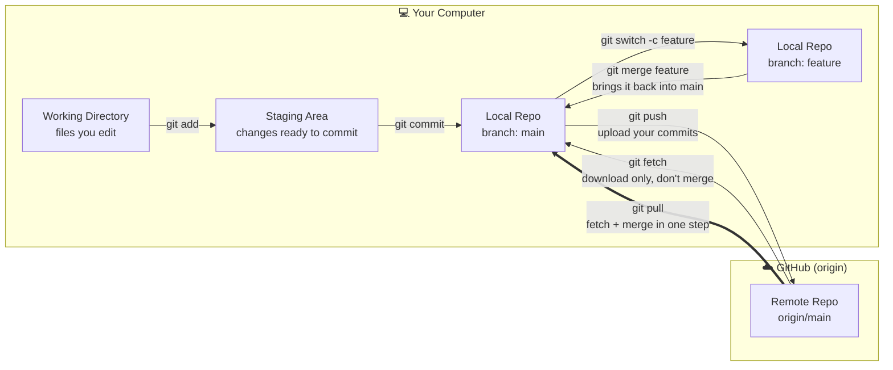

# Practice Exercises

Work through these in order. Each one builds on the last. Do these in a
throwaway copy of this folder/repo — it's meant for breaking things.

## The Big Picture: Branches, Merges, and GitHub

Before diving in, here's the mental model every exercise below is built
on. Your **local repo** has branches and merges; GitHub is just another
copy of that repo ("the remote") that you sync with using
push/fetch/pull.



**Why this matters:**
- **Branches exist so work-in-progress never breaks `main`.** You can
  experiment, commit broken code, and abandon a branch entirely — `main`
  is untouched until you deliberately `merge`.
- **Merging is just "combine this branch's history into mine."** Git
  does it automatically when the changes don't overlap. When two
  branches edited the *same lines*, Git can't guess which one is
  correct — that's a **conflict**, and it stops to ask you.
- **Push and pull are the same idea, applied to a remote copy.** GitHub
  doesn't know about your commits until you `push`. You don't know
  about a teammate's commits until you `fetch` or `pull`. Nothing is
  shared automatically — that's what prevents accidental overwrites of
  other people's work.
- **`pull` = `fetch` + `merge`.** That's why a `pull` can conflict too:
  under the hood it's merging `origin/main` into your `main`, exactly
  like merging a local branch.

Keep this diagram open while you do Exercises 3, 4, and 7 — they are
literally this picture, one arrow at a time.

## Exercise 1 — First commit

**Why:** Git can't protect or version anything it doesn't know about.
`add` + `commit` is how you deliberately tell Git "this is a snapshot
worth remembering," as opposed to a text editor's autosave which just
overwrites the previous state with no history.

1. `git status` — see `team-notes.txt`, `todo.txt`, `recipe.txt` as untracked
   (if this is a fresh clone) or already committed (if cloned from the
   training repo as-is).
2. Open `team-notes.txt`, add a line under the agenda list.
3. `git add team-notes.txt` — *stages* the change. Staging exists so you
   can choose exactly what goes into the next snapshot, even if you've
   edited five files but only want to commit one of them right now.
4. `git commit -m "Update team notes"` — creates the permanent snapshot.
   The message matters: six months from now, `git log` is how someone
   (maybe you) figures out *why* a line changed, not just that it did.
5. `git log --oneline` to confirm.

## Exercise 2 — Diff before you commit

**Why:** `status` tells you *which files* changed; `diff` tells you
*exactly what* changed, line by line. Reading your diff before
committing is the single habit that catches the most embarrassing
mistakes — leftover debug code, accidental deletions, secrets pasted in
by accident.

1. Edit `todo.txt`, check off one item by changing `[ ]` to `[x]`.
2. `git diff` — notice it shows the change *before* staging. This is
   your last chance to review before the change even enters staging.
3. `git add todo.txt`
4. `git diff --staged` — same change, now shown as staged. Git
   deliberately separates these two views (unstaged vs. staged) so you
   always know exactly what the *next commit* will contain, even if
   your working directory has other unrelated edits sitting around.
5. `git commit -m "Check off first todo item"`

## Exercise 3 — Branching

**Why:** Refer to the diagram above — this exercise is the
`main -> git switch -c feature -> feature` arrow. Branching gives you an
isolated line of history to experiment in. If step 2 below goes
horribly wrong, `main` was never touched; you just delete the branch
and nothing is lost.

1. `git switch -c practice/add-step` — creates the branch *and* moves
   you onto it in one step. Everything you commit from here only
   exists on `practice/add-step` until it's merged.
2. Edit `recipe.txt`, add a 4th step to the Steps list (e.g. "Serve with
   syrup and fruit.").
3. `git add recipe.txt && git commit -m "Add serving step to recipe"`
4. `git switch main` — notice `recipe.txt` reverts to the 3-step version
   in your working directory. **This is expected, not a bug**: your
   commit still exists on `practice/add-step`, Git is just showing you
   `main`'s version of the file because that's the branch you're
   standing on right now.

## Exercise 4 — Merge conflict (do this as a pair/group)

**Why:** This is the `feature -- git merge feature --> main` arrow from
the diagram, except we're deliberately engineering the "two branches
edited the same line" scenario so you experience a conflict safely,
with the team, before it happens for real with something that matters.

1. On `main`, edit `recipe.txt`'s step 3 to say "Cook on a hot griddle
   until golden brown, then flip carefully." Commit it on `main`.
   *(Now both `main` and `practice/add-step` have diverged from the
   same original file — exactly like two teammates editing the same
   function in parallel.)*
2. Switch back: `git switch practice/add-step`.
3. `git merge main` — this should conflict on `recipe.txt` because both
   branches touched overlapping content. **Git stopping here is a
   feature, not a failure** — it refuses to silently pick a winner and
   possibly delete someone's work.
4. Open `recipe.txt`, find the `<<<<<<<` / `=======` / `>>>>>>>` markers.
   Everything between `<<<<<<<` and `=======` is *your current
   branch's* version; between `=======` and `>>>>>>>` is the *incoming*
   version. Git shows you both because only a human knows which one
   (or what combination) is actually correct.
5. Edit the file to keep both the step-3 wording change and the new
   4th step, then remove the conflict markers.
6. `git add recipe.txt` — this is how you tell Git "I've resolved this
   file," even though nothing else about `add` changed.
7. `git commit` (an editor will open with a pre-filled merge message —
   save and close it, or pass `-m "Merge main into practice/add-step"`).
   This creates a special **merge commit** with two parent commits,
   permanently recording that these two lines of history rejoined here.
8. `git log --oneline --graph --all` — see the merge commit tying both
   branches together. This is the same shape as the diagram's left-hand
   side, just drawn vertically through time instead of horizontally.

## Exercise 5 — Stash

**Why:** You're mid-edit, something urgent comes up (a bug report, a
teammate needs you on another branch), and your current change isn't
ready to commit. Without stash, your only options would be to commit
something half-finished or lose the edit by switching branches. Stash
is a third option: a temporary shelf.

1. Edit `team-notes.txt` but don't commit.
2. `git stash` — working directory is clean again. The edit isn't gone,
   it's just set aside.
3. `git switch main`, then back to your branch.
4. `git stash pop` — your edit returns. "Pop" both re-applies it and
   removes it from the stash list, so you don't end up re-applying the
   same stash twice by accident later.

## Exercise 6 — Undoing

**Why:** Different situations call for different kinds of "undo," and
picking the wrong one can cause real problems once you've pushed to a
shared remote.

1. Make an unwanted edit to `todo.txt` and commit it.
2. `git revert HEAD` — creates a **new** commit that undoes the last
   one, rather than deleting it. Use this once a commit is pushed or
   shared: it preserves history (so teammates' copies aren't
   contradicted) while still fixing the mistake going forward.
3. Make another unwanted edit to `todo.txt`, don't commit it this time.
4. `git restore todo.txt` — discards the uncommitted change entirely.
   This is safe *only* because nothing was committed yet — there's no
   history to protect, so there's nothing wrong with throwing it away.

## Exercise 7 — Remote sync (optional, pairs well with a teammate)

**Why:** This is the right-hand side of the diagram above —
`push`/`fetch`/`pull` between your local repo and GitHub. Everything
you've practiced so far (commits, branches, merges) happens locally
first; these commands are how that work actually reaches your team.

If your team has set up a shared remote for this practice repo:

```bash
git push -u origin practice/add-step
```

- `push` uploads your local commits to GitHub. The `-u` (set upstream)
  only needs to happen once per branch — it tells Git "remember that my
  local `practice/add-step` corresponds to `origin/practice/add-step`,"
  so future pushes/pulls on this branch don't need the full
  `origin practice/add-step` spelled out.
- Nothing on GitHub changes until this `push` runs. That's deliberate:
  you control exactly when your local commits become visible to
  everyone else.

Then have a teammate run:

```bash
git fetch     # downloads what's new on GitHub, but doesn't touch your files yet
git pull      # downloads AND merges into your current branch, in one step
```

- `fetch` is the "look before you leap" option — it updates your
  knowledge of `origin/main` without changing your working directory,
  so you can inspect what changed (`git log main..origin/main`) before
  deciding to merge it in.
- `pull` is `fetch` + `merge` combined — convenient for the common case,
  but remember it can conflict exactly like Exercise 4 did, just
  between your branch and the remote's branch instead of two local
  branches.
